  

 

## About me

I am a SENAI student developing software projects aimed at solving real-world problems. I am especially interested in web applications, management systems and artificial intelligence in software development.

I enjoy exploring the entire process of building an application, from the initial idea and interface to database design, authentication, testing and deployment.

## Technologies and tools

### Frontend

    

### Backend & databases

   

### Version control & deployment

  

### Automation & creative coding

 

## Artificial intelligence in my workflow

Planning, learning concepts and exploring solutions.

Feature implementation, debugging and code maintenance.

Requirements analysis, architecture and implementation review.

**My workflow:** Idea → Planning → Implementation → Testing → Review

I use AI to support development, aiming to understand solutions and test code before incorporating it into my projects.

## GitHub statistics

## Contributions & activity

  

Decorative animation inspired by the GitHub calendar.

[View official contribution calendar →](https://github.com/pedrowenz-a17y#contributions)

## What I am exploring

- Full-stack development and SaaS application architecture.
- PostgreSQL, authentication and Row Level Security (RLS).
- Process automation and AI integration.
- Video production and animation with React and Remotion.
- Robotics and prototyping with Arduino.

---

**Thanks for visiting!**

[Let's connect on LinkedIn](https://www.linkedin.com/in/pedro-wenz-866302271/)

