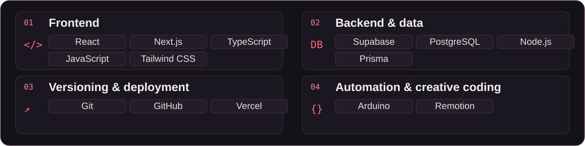
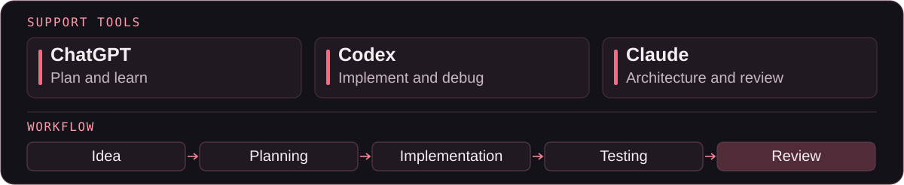

  

 

## 01 / About me

I am a SENAI student developing software projects aimed at solving real-world problems. I am especially interested in web applications, management systems and artificial intelligence in software development.

I enjoy exploring the entire process of building an application, from the initial idea and interface to database design, authentication, testing and deployment.

## 02 / Technologies and tools

Technology list

**Frontend:** React, Next.js, TypeScript, JavaScript and Tailwind CSS.

**Backend & data:** Supabase, PostgreSQL, Node.js and Prisma.

**Versioning & deployment:** Git, GitHub and Vercel.

**Automation & creative coding:** Arduino and Remotion.

## 03 / Artificial intelligence in my workflow

I use **ChatGPT** to learn and organize ideas, **Codex** to implement features and investigate bugs, and **Claude** to discuss architecture and review solutions. I aim to understand suggestions and test code before incorporating it into my projects.

## 04 / GitHub statistics

  

[View contribution streak](https://streak-stats.demolab.com/?user=pedrowenz-a17y&theme=dark&hide_border=true&background=141219&ring=FF687A&fire=FF687A&currStreakLabel=FF7585&currStreakNum=E7EDF7&sideNums=E7EDF7&sideLabels=D6E0EE&dates=94A3B8&stroke=482634&hide_total_contributions=true&locale=en)

## 05 / Contributions & activity

  

Decorative animation inspired by Chrome's dinosaur game and GitHub's contribution calendar.

[View official contribution calendar →](https://github.com/pedrowenz-a17y#contributions)

## 06 / What I am exploring

- Full-stack development and SaaS application architecture.
- PostgreSQL, authentication and Row Level Security (RLS).
- Process automation and AI integration.
- Video production and animation with React and Remotion.
- Robotics and prototyping with Arduino.

**Thanks for visiting!**

[Let's connect on LinkedIn](https://www.linkedin.com/in/pedro-wenz-866302271/)

