**Português (BR)** · [English (EN)](./README.en.md)

## Sobre mim

Sou estudante do SENAI e desenvolvo projetos de software voltados à resolução de problemas reais. Tenho interesse especial em aplicações web, sistemas de gestão e inteligência artificial aplicada ao desenvolvimento.

Gosto de explorar todo o processo de criação de uma aplicação: da ideia e da interface à estrutura do banco de dados, autenticação, testes e publicação.

## Tecnologias e ferramentas

### Frontend

    

### Backend e banco de dados

   

### Versionamento e publicação

  

### Automação e desenvolvimento criativo

 

## Inteligência artificial no meu fluxo de trabalho

Planejamento, estudo de conceitos e exploração de soluções.

Implementação de funcionalidades, investigação de bugs e manutenção de código.

Análise de requisitos, arquitetura e revisão de implementações.

**Meu fluxo:** Ideia → Planejamento → Implementação → Testes → Revisão

Utilizo a IA como apoio ao desenvolvimento, buscando compreender as soluções e testar o código antes de incorporá-lo aos projetos.

## Projeto em destaque

### [Essenza — SaaS para empresas de estética](https://github.com/pedrowenz-a17y/SaaS-Essenza)

Aplicação de gestão para pequenas empresas de beleza, com foco na rotina de atendimento.

- Agenda, clientes, profissionais e serviços.
- Controle de estoque e gestão financeira.
- Lembretes automatizados e gerenciamento de permissões.

**Stack:** Next.js · TypeScript · Supabase · Tailwind CSS

[Ver repositório →](https://github.com/pedrowenz-a17y/SaaS-Essenza)

## O que estou explorando

- Desenvolvimento full stack e arquitetura de aplicações SaaS.
- PostgreSQL, autenticação e segurança com Row Level Security (RLS).
- Automação de processos e integração de inteligência artificial.
- Produção de vídeos e animações utilizando React e Remotion.
- Robótica e prototipagem com Arduino.

---

**Obrigado pela visita!**

[Vamos conversar no LinkedIn](https://www.linkedin.com/in/pedro-wenz-866302271/)

