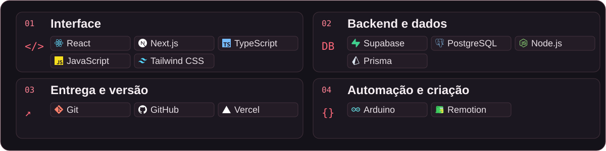

  

 

## 01 / Sobre mim

Sou estudante do SENAI e desenvolvo projetos de software voltados à resolução de problemas reais. Tenho interesse especial em aplicações web, sistemas de gestão e inteligência artificial aplicada ao desenvolvimento.

Gosto de explorar todo o processo de criação de uma aplicação: da ideia e da interface à estrutura do banco de dados, autenticação, testes e publicação.

## 02 / Tecnologias e ferramentas

Lista de tecnologias

**Interface:** React, Next.js, TypeScript, JavaScript e Tailwind CSS.

**Backend e dados:** Supabase, PostgreSQL, Node.js e Prisma.

**Versionamento e publicação:** Git, GitHub e Vercel.

**Automação e criação:** Arduino e Remotion.

## 03 / Inteligência artificial no meu fluxo de trabalho

Uso **ChatGPT** para estudar e organizar ideias, **Codex** para implementar funcionalidades e investigar bugs, e **Claude** para discutir arquitetura e revisar soluções. Busco compreender as sugestões e testar o código antes de incorporá-lo aos projetos.

## 04 / Estatísticas do GitHub

  

[Consultar sequência de dias](https://streak-stats.demolab.com/?user=pedrowenz-a17y&theme=dark&hide_border=true&background=141219&ring=FF687A&fire=FF687A&currStreakLabel=FF7585&currStreakNum=E7EDF7&sideNums=E7EDF7&sideLabels=D6E0EE&dates=94A3B8&stroke=482634&hide_total_contributions=true&locale=pt_BR)

## 05 / Contribuições e atividade

  

[Ver calendário oficial de contribuições →](https://github.com/pedrowenz-a17y#contributions)

## 06 / O que estou explorando

- Desenvolvimento full stack e arquitetura de aplicações SaaS.
- PostgreSQL, autenticação e segurança com Row Level Security (RLS).
- Automação de processos e integração de inteligência artificial.
- Produção de vídeos e animações utilizando React e Remotion.
- Robótica e prototipagem com Arduino.

**Obrigado pela visita!**

[Vamos conversar no LinkedIn](https://www.linkedin.com/in/pedro-wenz-866302271/)

